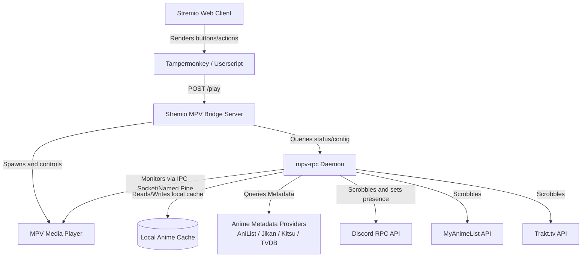
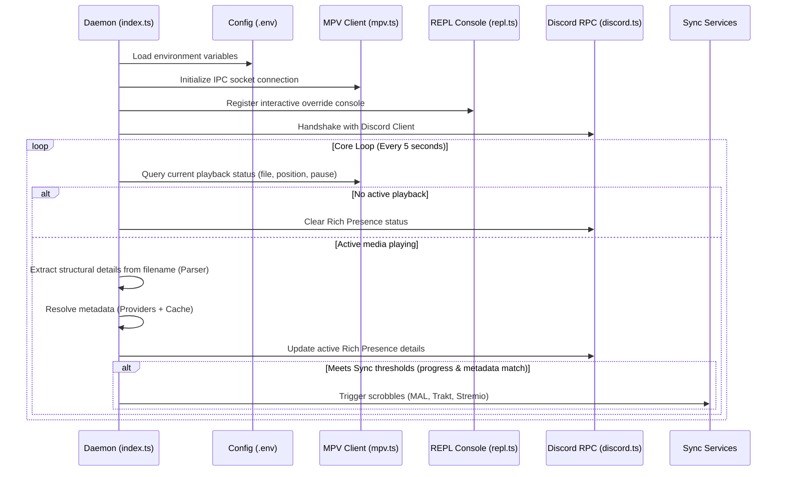

# System Architecture (mpv-rpc)

This document details the design, data flow, and directory structure of the **mpv-rpc** project. It serves as the developer and AI agent guide to understanding how all components integrate.

---

## 1. System Overview

**mpv-rpc** is a background application written in TypeScript that monitors active video playback in a local **MPV** media player and synchronizes progress in real-time with third-party tracking services, while also updating Discord Rich Presence.

The ecosystem consists of two primary modules:
1. **Node Daemon (Core & RPC)**: Runs locally. Connects to MPV via IPC, extracts metadata, queries external APIs, and coordinates scrobbles.
2. **Stremio Bridge**: A local HTTP channel (`stremio-mpv-bridge/`) consisting of a Node server and a browser Userscript. This allows opening video streams from Stremio Web directly in the local MPV player.

### High-Level Data Flow Diagram



---

## 2. Directory Structure of `src/`

The source files are organized into clean modules that isolate core intelligence, network integrations, and platform-specific synchronization routines:

```
src/
├── core/                               # Core intelligence and shared utilities
│   ├── anime.ts                        # Anime metadata resolution and provider fallbacks
│   ├── auto-fetch.ts                   # Active checking and stream auto-fetching triggers
│   ├── config.ts                       # Dotenv configuration parser and loader
│   ├── parser.ts                       # Filename extraction (Title/Season/Episode)
│   ├── playbackIdentity.ts             # Playback identity canonical model
│   ├── canonical-episode.ts            # Canonical episode position resolution
│   ├── bridge-config-migration.ts      # Configuration migrations and validation rules
│   └── userscript-config-sync.ts       # Configuration sync with the userscript
│
├── integrations/                      # Hardware/system socket integration layers
│   ├── mpv.ts                         # IPC socket/named pipe client for MPV
│   └── discord.ts                     # Handshake and Rich Presence client for Discord RPC
│
├── stremio-sync/                      # Stremio library scrobbling implementation
├── trakt-sync/                        # Trakt.tv scrobbling and authentication flow
├── mal-sync/                          # MyAnimeList status update and OAuth device flow
├── providers/                         # Dedicated metadata provider APIs
├── console/                           # Interactive REPL console wrapper for manual overrides
├── functions/                         # Global TypeScript type declarations
└── index.ts                           # Core daemon initialization entrypoint
```

---

## 3. Daemon Execution Flow (`src/index.ts`)

Upon launch (`npm start`), the daemon establishes system loops and enters the following lifecycle:



---

## 4. Stremio Bridge (`stremio-mpv-bridge/`)

The Stremio bridge lets you watch streams from Stremio Web directly in your native MPV player while preserving sync:

1. **Browser Integration**: `stremio-mpv.user.js` (Tampermonkey Userscript) inspects the browser route. When a user navigates to a `/detail/...` page, it injects a floating **"Open in MPV"** button.
2. **Local Handler**: Clicking this button sends a `POST /play` request containing the stream URL and metadata to the local bridge server (`stremio-mpv-bridge/server.js`) listening on port `3000`.
3. **Player Spawning**: The bridge server spawns **MPV** as a child process, forwards the stream URL, and connects to the player's IPC socket to manage its state.

---

## 5. Metadata Resolution and Caching

Querying external APIs on every video event would quickly trigger provider rate limits. The app implements a strict caching policy in `src/core/anime.ts`:

### Provider Fallback Order
To ensure high metadata coverage (especially for localized titles), the system queries providers in this priority order:

1. **Jikan (MyAnimeList)**: Primary provider for anime identity mapping and canonical titles.
2. **AniList**: Used if Jikan queries fail or trigger rate limits.
3. **Kitsu**: Fallback for secondary matches.
4. **TVDB**: Utilized specifically to fetch localized episode titles (e.g. Portuguese).

### Cache Retention Policy (`.anime_cache/`)
* **Hits (Successful queries)**: Retained for **24 hours** in `.anime_cache/anime_cache.json`.
* **Misses (Not Found)**: Retained for **10 minutes** to prevent continuous API spam for unknown media.

> [!TIP]
> During development or when troubleshooting mismatch issues, delete `.anime_cache/anime_cache.json` to force a clean remote fetch.

---

## 6. Progress Synchronization (MAL, Trakt, Stremio)

Synchronization endpoints trigger only when specific watch thresholds are crossed:

| Service | Driver Code | Activation Condition | Progress Action |
| :--- | :--- | :--- | :--- |
| **Discord RPC** | `src/integrations/discord.ts` | Configured as enabled. | Real-time status display. |
| **MyAnimeList** | `src/mal-sync/sync.ts` | `MAL_SYNC=true` + Active OAuth session. | Marks as watched at >= 90% progress. |
| **Trakt.tv** | `src/trakt-sync/sync.ts` | `TRAKT_SYNC=true` + Authorized API. | Incremental scrobble updates (watched at >= 85%). |
| **Stremio Library** | `src/stremio-sync/sync.ts` | Active Stremio credentials. | Syncs "Continue Watching" state every 30s. |
