<div align="center">

<h1>
  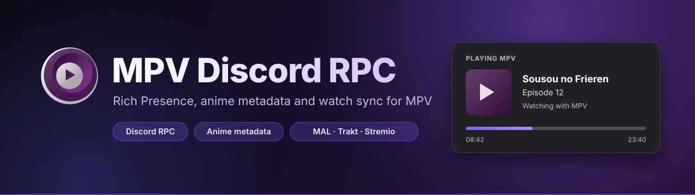
</h1>

**Discord Rich Presence for MPV with anime metadata, optional watch sync, and Stremio Web playback through MPV.**

<p>
  <a href="https://github.com/gabszap/mpv-rpc/releases"></a>
  <a href="https://github.com/gabszap/mpv-rpc/tree/main/stremio-mpv-bridge"></a>
  <a href="https://github.com/gabszap/mpv-rpc/actions/workflows/ci.yml"></a>
  
</p>
<p>
  
  
  
  
</p>

<p>
  <a href="#highlights">Highlights</a> ·
  <a href="#quick-start">Quick start</a> ·
  <a href="#stremio-bridge">Stremio</a> ·
  <a href="#sync-services">Sync</a> ·
  <a href="#configuration-reference">Configuration</a> ·
  <a href="#troubleshooting">Troubleshooting</a>
</p>


<br>
<em>Discord Rich Presence in action</em>

<p>
  <a href="README.md"><b>English</b></a> · <a href="docs/README_PT.md">Português</a>
</p>

</div>

---

## Highlights

**MPV Discord RPC** watches your MPV playback through IPC and turns it into Discord Rich Presence. For anime files it parses the filename, fetches metadata and cover art, resolves episode titles, and can sync watch progress to MyAnimeList, Trakt.tv and Stremio.

| | |
| --- | --- |
| **Discord Rich Presence** | Live playback status, pause/playing state, progress, privacy mode, optional idle hiding |
| **Anime metadata** | Filename parsing, cover art, official titles, localized episode titles, local cache |
| **Multiple providers** | Jikan/MyAnimeList, AniList, Kitsu and TheTVDB, with automatic fallback |
| **Resilient parser** | GuessIt API → local GuessIt CLI → regex fallback |
| **Watch sync** | MyAnimeList progress, Trakt.tv scrobbling, Stremio Continue Watching and watched marking |
| **Stremio bridge** | Userscript + local server that opens Stremio Web streams in MPV with playlist support |

> [!NOTE]
> Cover art is focused on anime metadata. For non-anime files the app still shows playback status, just without anime-specific metadata.

## Requirements

- **Node.js 22** or newer
- **MPV** Media Player
- **Discord Desktop**, if `DISCORD_RPC=true`
- *Optional:* Python 3.12+ and `guessit`, only if you want local GuessIt parsing instead of the cloud API
- *Optional:* a userscript manager such as Tampermonkey or Violentmonkey, for Stremio Web integration

## Quick start

### 1. Install

```bash
git clone https://github.com/gabszap/mpv-rpc.git
cd mpv-rpc
npm install
```

### 2. Create your `.env`

```bash
# Windows PowerShell
Copy-Item .env.example .env

# Linux/macOS
cp .env.example .env
```

For the default no-Python parser setup, keep:

```env
USE_GUESSIT_API=true
GUESSIT_API_URL=https://guessit-api.vercel.app/api/parse
```

### 3. Enable MPV IPC

Add this to your `mpv.conf`:

```ini
# Windows
input-ipc-server=\\.\pipe\mpv

# Linux/macOS
input-ipc-server=/tmp/mpv-socket
```

Or start MPV manually with:

```bash
# Windows
mpv --input-ipc-server=\\.\pipe\mpv <file>

# Linux/macOS
mpv --input-ipc-server=/tmp/mpv-socket <file>
```

### 4. Build and run

```bash
npm run build
npm start
```

For development, build and run in one command:

```bash
npm run dev
```

> [!TIP]
> Pick the setup that fits you: **Discord only** is exactly the four steps above. For Stremio Web playback, continue with the [Stremio bridge](#stremio-bridge) section.

## Stremio bridge

The **Stremio MPV Bridge** is a separate workspace: a Violentmonkey/Tampermonkey userscript plus a local server that lets Stremio Web open streams directly in MPV, with single, batch or full-series playlist modes and provider settings.

1. Complete the Quick start above.
2. Install `stremio-mpv-bridge/stremio-mpv.user.js` in your userscript manager.
3. Start both services:

   ```bash
   npm run start:all
   ```

4. Open `https://web.stremio.com/`, choose an episode or movie, and use the MPV bridge button or shortcut.

Full guide: [Stremio MPV Bridge Guide](docs/stremio-mpv-bridge.md)

## Sync services

| Service | Enable in `.env` | Auth command | Guide |
| --- | --- | --- | --- |
| **MyAnimeList** | `MAL_SYNC=true` | `npm start -- mal-auth` | [MAL guide](docs/mal-sync-setup.md) |
| **Trakt.tv** | `TRAKT_SYNC=true` | `npm start -- trakt-auth` | [Trakt guide](docs/trakt-sync-setup.md) |
| **Stremio** | `STREMIO_SYNC=true` | Open media through the bridge so it can capture context/auth | [Stremio guide](docs/stremio-mpv-bridge.md) |

Tokens and Stremio context are stored under `.config/`, which is ignored by git.

> [!IMPORTANT]
> Some anime sync mappings use TheTVDB to safely convert aired/default season+episode numbers to absolute episode numbers, even when `METADATA_PROVIDER` is not `tvdb`. Set `TVDB_API_KEY` for those cases; without it, ambiguous syncs are skipped rather than guessed.

## Filename parsing

The parser tries the safest available method, in this order:

1. **GuessIt API**: enabled when `USE_GUESSIT_API=true` and `GUESSIT_API_URL` is set.
2. **Local GuessIt CLI**: used when the API is unavailable and `guessit` is installed locally.
3. **Regex fallback**: always available for basic title/episode extraction.

<details>
<summary><b>Public GuessIt API</b></summary>

<br>

The default public endpoint is:

```env
USE_GUESSIT_API=true
GUESSIT_API_URL=https://guessit-api.vercel.app/api/parse
```

Only filenames are sent to the API. If you prefer maximum privacy or expect heavy usage, deploy your own API from the included `guessit-api/` folder.

</details>

<details>
<summary><b>Deploy your own GuessIt API</b></summary>

<br>

```bash
cd guessit-api
npm i -g vercel
vercel
```

Then set the deployed endpoint in your root `.env`:

```env
USE_GUESSIT_API=true
GUESSIT_API_URL=https://your-project.vercel.app/api/parse
```

</details>

## Configuration reference

Copy `.env.example` to `.env`, then adjust only what you need. Missing values fall back to runtime defaults.

<details>
<summary><b>Core settings</b></summary>

<br>

| Variable | Default | Description |
| --- | --- | --- |
| `DISCORD_CLIENT_ID` | bundled app ID | Discord application client ID |
| `DISCORD_RPC` | `true` | Enable Discord Rich Presence |
| `SHOW_COVER` | `true` | Show anime cover art when available |
| `PRIVACY_MODE` | `false` | Hide media details in Discord |
| `HIDE_IDLING` | `false` | Hide activity while MPV is idle |
| `SHOW_TITLE` | `true` | Use resolved title as Discord activity name |
| `TITLE_LANG` | `none` | Title language: `english`, `eng`, `romaji`, or `none` |
| `DEBUG` | `false` | Write detailed provider/sync logs under `.anime_cache/` |
| `AUTO_FETCH` | `true` | Global RPC-side kill switch for auto-fetching next episodes. Also requires the bridge config toggle `autoFetch.enabled` to be ON. |

</details>

<details>
<summary><b>MPV and bridge settings</b></summary>

<br>

| Variable | Default | Description |
| --- | --- | --- |
| `MPV_IPC_PATH` | Windows: `\\.\pipe\mpv`<br>Unix: `/tmp/mpv-socket` | IPC path shared by the RPC app and bridge |
| `MPV_PATH` | `mpv` | MPV executable path used by the bridge |
| `PORT` | `9632` | Bridge server port |

If you change `PORT`, update `CONFIG.SERVER_URL` in `stremio-mpv-bridge/userscript/src/constants.js`, then run `npm run build:userscript` to regenerate `stremio-mpv-bridge/stremio-mpv.user.js` so the userscript points to the same bridge URL.

</details>

<details>
<summary><b>Metadata and parser settings</b></summary>

<br>

| Variable | Default | Description |
| --- | --- | --- |
| `METADATA_PROVIDER` | `jikan` | Metadata provider: `jikan`, `anilist`, `kitsu`, or `tvdb` |
| `TVDB_API_KEY` | empty | TheTVDB API key, required when using `tvdb` as the primary provider and for safe sync episode order mapping |
| `TVDB_LANG` | `eng` | TheTVDB language code for episode metadata |
| `USE_GUESSIT_API` | `true` | Use HTTP GuessIt parsing before local CLI fallback |
| `GUESSIT_API_URL` | empty in code, public endpoint in `.env.example` | GuessIt API endpoint |

</details>

<details>
<summary><b>Sync settings</b></summary>

<br>

| Variable | Default | Description |
| --- | --- | --- |
| `MAL_SYNC` | `false` | Enable MyAnimeList episode progress sync |
| `MAL_CLIENT_ID` | empty | MyAnimeList API client ID |
| `MAL_SYNC_THRESHOLD` | `90` | Percent watched before MAL sync triggers |
| `TRAKT_SYNC` | `false` | Enable Trakt.tv scrobbling |
| `TRAKT_CLIENT_ID` | empty | Trakt API client ID |
| `TRAKT_CLIENT_SECRET` | empty | Trakt API client secret |
| `TRAKT_SYNC_THRESHOLD` | `81` | Percent watched before Trakt scrobble triggers |
| `TRAKT_USE_TOR` | `false` | Route Trakt requests through a Tor SOCKS5 proxy |
| `TRAKT_TOR_PROXY` | `socks5://127.0.0.1:9050` | Tor SOCKS5 proxy URL |
| `STREMIO_SYNC` | `false` | Enable Stremio Continue Watching and watched marking |
| `STREMIO_SYNC_THRESHOLD` | `85` | Percent watched before Stremio marks an item watched |
| `STREMIO_PROGRESS_INTERVAL_MS` | `90000` | Minimum delay between Continue Watching writes, clamped to at least `30000` |
| `SYNC_DRY_RUN` | `false` | When enabled, all sync operations (Trakt scrobble, Stremio datastore writes, Auto-Fetch requests, MAL sync) are logged but NOT executed. Safe for testing configuration without side effects. |

</details>

### Auto-Fetch (dual gate)

Auto-Fetch has two independent gates, and **both must be `true`** for it to fire:

| Gate | Where | Role |
| --- | --- | --- |
| `.env` → `AUTO_FETCH` (default `true`) | RPC side | Global kill switch. When `false`, the RPC never triggers auto-fetch, regardless of the bridge config. |
| Bridge config → `autoFetch.enabled` | Userscript modal (Playback → Auto-Fetch Episodes) | Per-instance fine control. When OFF, the bridge ignores auto-fetch requests even if the RPC triggers. |

> [!TIP]
> In practice you usually only need to disable Auto-Fetch in the bridge settings. Set `AUTO_FETCH=false` only when you want a global kill switch.

## How it works

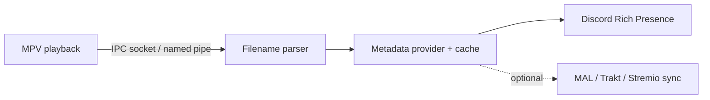

The Stremio bridge runs separately:

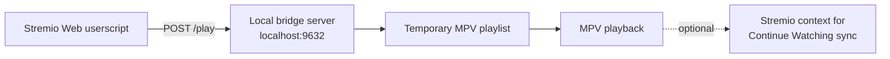

## Screenshots

### Title display modes

| Romaji title | English title | Filename fallback |
| :---: | :---: | :---: |
| 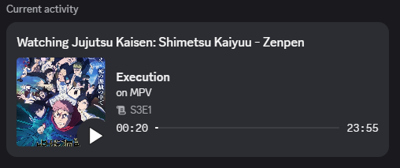 | 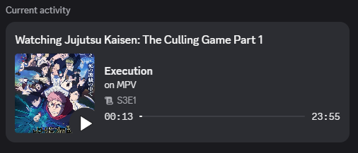 | 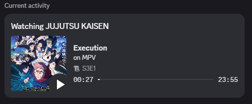 |

> *Filename* means the anime title is taken from the filename (no metadata provider used).

### Localized episode titles (TVDB)

> [!NOTE]
> Localized episode titles are only available with the TVDB metadata provider.

| English | Portuguese | Spanish |
| :---: | :---: | :---: |
|  | 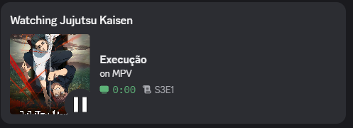 | 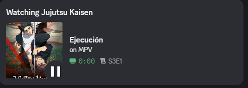 |

| French | German | Italian |
| :---: | :---: | :---: |
| 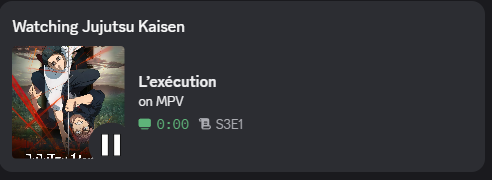 | 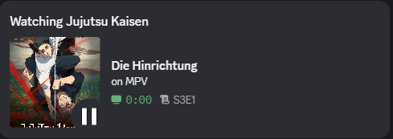 | 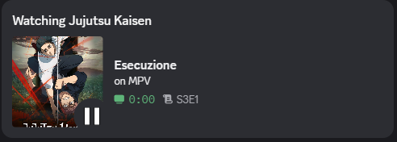 |

| Russian | Chinese | Japanese |
| :---: | :---: | :---: |
| 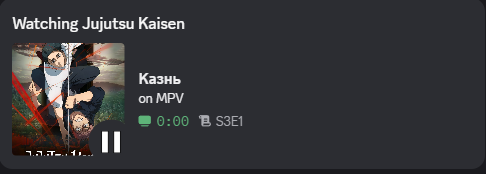 | 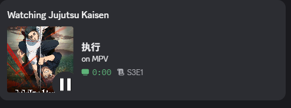 | 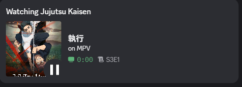 |

### Privacy mode

<p align="center">
  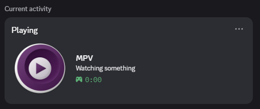
</p>

## Troubleshooting

| Problem | Check |
| --- | --- |
| Discord status does not appear | Discord Desktop is running, `DISCORD_RPC=true`, app was rebuilt after config changes |
| MPV is not detected | `input-ipc-server` in `mpv.conf` matches `MPV_IPC_PATH` |
| Stremio button says server offline | Run `npm run bridge` or `npm run start:all` |
| Stremio works on a custom port in the browser but not in the userscript | Update `CONFIG.SERVER_URL` in `stremio-mpv-bridge/userscript/src/constants.js` and run `npm run build:userscript` |
| Anime title/episode looks wrong | Clear `.anime_cache/`, enable `DEBUG=true`, check parser/provider logs |
| MAL or Trakt does not sync | Re-run the auth command and confirm the relevant `*_SYNC=true` setting |

## Development

```bash
npm install          # install dependencies
npm run build        # compile TypeScript to dist/
npm test             # run the test suite (Vitest)
npm run check        # lint and format check (Biome)
```

The Stremio userscript is **generated**: edit `stremio-mpv-bridge/userscript/src/` (and `header.txt`), then run `npm run build:userscript`. `npm run check:userscript` fails when the committed `stremio-mpv.user.js` is out of date. CI runs the lint, build, tests and userscript check on every pull request.

More: [Architecture](docs/ARCHITECTURE.md) · [Contributing](docs/CONTRIBUTING.md) · [Roadmap](docs/ROADMAP.md) · [AGENTS.md](AGENTS.md)

### Releases

Releases are automated with **semantic-release** and split into two independent streams:

| App | Tag format | Changelog | Scope |
| --- | --- | --- | --- |
| Root RPC app | `mpv-rpc-v${version}` | `CHANGELOG.md` | Non-bridge paths |
| Stremio bridge | `bridge-v${version}` | `stremio-mpv-bridge/CHANGELOG.md` | `stremio-mpv-bridge/**` |

Use Conventional Commits. Do not run `npm version` manually for project releases.

Local release helpers:

```bash
npm run release:dry
npm run release
npm run release:bridge:dry
npm run release:bridge
```

For local semantic-release runs, keep `GH_TOKEN` or `GITHUB_TOKEN` in `.env`.

## Recommended MPV scripts

| Script | Description |
| --- | --- |
| [SmartSkip](https://github.com/Eisa01/mpv-scripts#smartskip) | Automatically skip intros, outros, and silence |
| [SmartCopyPaste](https://github.com/Eisa01/mpv-scripts#smartcopypaste) | Copy/paste video paths, URLs, and timestamps |

## Credits

- [iamkroot/trakt-scrobbler](https://github.com/iamkroot/trakt-scrobbler): reference implementation for Trakt.tv scrobbling and OAuth device flow patterns.
- [PreMiD](https://premid.app/): asset reference.

## License

MIT License. See [LICENSE](LICENSE) for details.
