# MPV Discord RPC

Discord Rich Presence para o MPV Media Player com metadados de anime, sincronização opcional de progresso e integração do Stremio Web com MPV.

<p align="center">
  
  
  
  
  
  
</p>

<p align="center">
  
  <br>
  <em>Discord Rich Presence em ação</em>
</p>

<p align="center">
  <a href="../README.md">English</a> | <a href="README_PT.md">Português</a>
</p>

---

## O que este projeto faz

O **MPV Discord RPC** acompanha a reprodução do MPV via IPC e transforma isso em Rich Presence no Discord. Para arquivos de anime, ele consegue analisar o nome do arquivo, buscar metadados e capa, resolver títulos de episódios e, opcionalmente, sincronizar progresso com MyAnimeList, Trakt.tv e Stremio.

O projeto também inclui o **Stremio MPV Bridge**, um workspace separado que permite abrir streams do Stremio Web diretamente no MPV com suporte a playlists.

## Visão geral dos recursos

| Área | Recursos |
| --- | --- |
| Discord RPC | Status em tempo real, estado pausado/reproduzindo, progresso, modo privacidade, opção para ocultar idle |
| Metadados de anime | Parsing de nome de arquivo, capa, títulos oficiais, títulos de episódio, cache local |
| Provedores | Jikan/MyAnimeList, AniList, Kitsu, TheTVDB |
| Fallback do parser | API GuessIt, CLI local do GuessIt, regex fallback |
| Sincronização | Progresso no MyAnimeList, scrobble no Trakt.tv, Continue Watching e marcação de assistido no Stremio |
| Bridge do Stremio | Userscript no navegador, servidor local, abertura no MPV, modos de playlist single/batch/all, configuração de provedores |
| Fluxo de desenvolvimento | TypeScript, Vitest, Biome, semantic-release, releases independentes para app raiz e bridge |

> A exibição de capa é focada em metadados de anime. Para arquivos que não forem anime, o app ainda pode mostrar o status de reprodução sem metadados específicos.

## Requisitos

- Node.js 22 ou mais recente
- MPV Media Player
- Discord Desktop, se `DISCORD_RPC=true`
- Opcional: Python 3.12+ e `guessit`, apenas se você quiser usar o parser local em vez da API em nuvem
- Opcional: gerenciador de userscript, como Tampermonkey ou Violentmonkey, para integração com Stremio Web

## Início rápido

### 1. Instalar

```bash
git clone https://github.com/gabszap/mpv-rpc.git
cd mpv-rpc
npm install
```

### 2. Criar o `.env`

```bash
# Windows PowerShell
Copy-Item .env.example .env

# Linux/macOS
cp .env.example .env
```

Para o setup padrão sem Python, mantenha:

```env
USE_GUESSIT_API=true
GUESSIT_API_URL=https://guessit-api.vercel.app/api/parse
```

### 3. Habilitar IPC no MPV

Adicione isto ao seu `mpv.conf`:

```ini
# Windows
input-ipc-server=\\.\pipe\mpv

# Linux/macOS
input-ipc-server=/tmp/mpv-socket
```

Ou inicie o MPV manualmente com:

```bash
# Windows
mpv --input-ipc-server=\\.\pipe\mpv <arquivo>

# Linux/macOS
mpv --input-ipc-server=/tmp/mpv-socket <arquivo>
```

### 4. Compilar e executar

```bash
npm run build
npm start
```

Para desenvolvimento, compile e rode em um comando:

```bash
npm run dev
```


## Caminhos de configuração

### Apenas Discord RPC básico

Use este caminho se você só quer exibir a reprodução do MPV no Discord:

1. Instale as dependências.
2. Copie `.env.example` para `.env`.
3. Habilite IPC no `mpv.conf`.
4. Rode `npm run build && npm start`.

### Discord RPC + reprodução do Stremio Web no MPV

Use este caminho se você quer abrir streams do Stremio Web no MPV:

1. Complete o setup básico do Discord RPC.
2. Instale `stremio-mpv-bridge/stremio-mpv.user.js` no seu gerenciador de userscript.
3. Inicie os dois serviços:

   ```bash
   npm run start:all
   ```

4. Abra `https://web.stremio.com/`, escolha um episódio/filme e use o botão ou atalho do MPV Bridge.

Guia completo: [Guia do Stremio MPV Bridge](stremio-mpv-bridge.md)

### Serviços de sincronização

| Serviço | Ativar no `.env` | Comando de autenticação | Guia |
| --- | --- | --- | --- |
| MyAnimeList | `MAL_SYNC=true` | `npm start -- mal-auth` | [Guia MAL](mal-sync-setup.md) |
| Trakt.tv | `TRAKT_SYNC=true` | `npm start -- trakt-auth` | [Guia Trakt](trakt-sync-setup.md) |
| Stremio | `STREMIO_SYNC=true` | Abra uma mídia pelo bridge para capturar contexto/autenticação | [Guia Stremio](stremio-mpv-bridge.md) |

Tokens e contexto do Stremio ficam armazenados em `.config/`, pasta ignorada pelo git.

Alguns mapeamentos de sincronização de anime usam o TheTVDB para converter com segurança temporada+episódio em ordem aired/default para episódio absoluto, mesmo quando `METADATA_PROVIDER` não é `tvdb`. Configure `TVDB_API_KEY` nesses casos; sem ela, sincronizações ambíguas são puladas em vez de estimadas.

## Parsing de nomes de arquivo

O parser tenta o método mais seguro disponível nesta ordem:

1. **API GuessIt**: usada quando `USE_GUESSIT_API=true` e `GUESSIT_API_URL` está configurado.
2. **CLI local do GuessIt**: usada quando a API não está disponível e `guessit` está instalado localmente.
3. **Regex fallback**: sempre disponível para extração básica de título/episódio.

### API pública do GuessIt

O endpoint público padrão é:

```env
USE_GUESSIT_API=true
GUESSIT_API_URL=https://guessit-api.vercel.app/api/parse
```

Apenas nomes de arquivos são enviados para a API. Se você preferir máxima privacidade ou espera uso intenso, faça o deploy da sua própria API usando a pasta `guessit-api/` incluída no projeto.

### Deploy da sua própria API GuessIt

```bash
cd guessit-api
npm i -g vercel
vercel
```

Depois configure o endpoint gerado no `.env` da raiz:

```env
USE_GUESSIT_API=true
GUESSIT_API_URL=https://seu-projeto.vercel.app/api/parse
```

## Referência de configuração

Copie `.env.example` para `.env` e altere apenas o necessário. Valores ausentes usam os padrões de runtime.

<details>
<summary>Configurações principais</summary>

| Variável | Padrão | Descrição |
| --- | --- | --- |
| `DISCORD_CLIENT_ID` | ID embutido do app | Client ID da aplicação Discord |
| `DISCORD_RPC` | `true` | Ativa Discord Rich Presence |
| `SHOW_COVER` | `true` | Mostra capa de anime quando disponível |
| `PRIVACY_MODE` | `false` | Oculta detalhes da mídia no Discord |
| `HIDE_IDLING` | `false` | Oculta atividade quando o MPV está idle |
| `SHOW_TITLE` | `true` | Usa o título resolvido como nome da atividade |
| `TITLE_LANG` | `none` | Idioma do título: `english`, `eng`, `romaji` ou `none` |
| `DEBUG` | `false` | Grava logs detalhados de provedores/sync em `.anime_cache/` |
| `AUTO_FETCH` | `true` | Kill switch global do lado do RPC para buscar próximos episódios. Também requer que o toggle `autoFetch.enabled` na config da bridge esteja ON. |

</details>

<details>
<summary>Configurações de MPV e bridge</summary>

| Variável | Padrão | Descrição |
| --- | --- | --- |
| `MPV_IPC_PATH` | Windows: `\\.\pipe\mpv`<br>Unix: `/tmp/mpv-socket` | Caminho IPC usado pelo app RPC e pelo bridge |
| `MPV_PATH` | `mpv` | Caminho do executável do MPV usado pelo bridge |
| `PORT` | `9632` | Porta do servidor do bridge |

Se você alterar `PORT`, também atualize `CONFIG.SERVER_URL` em `stremio-mpv-bridge/stremio-mpv.user.js` para o userscript apontar para a mesma URL do bridge.

</details>

<details>
<summary>Configurações de metadados e parser</summary>

| Variável | Padrão | Descrição |
| --- | --- | --- |
| `METADATA_PROVIDER` | `jikan` | Provedor de metadados: `jikan`, `anilist`, `kitsu` ou `tvdb` |
| `TVDB_API_KEY` | vazio | Chave da API TheTVDB, obrigatória quando `tvdb` é o provedor principal e para mapeamento seguro de ordem de episódios em sync |
| `TVDB_LANG` | `eng` | Código de idioma do TheTVDB para metadados de episódio |
| `USE_GUESSIT_API` | `true` | Usa parsing HTTP do GuessIt antes do fallback por CLI local |
| `GUESSIT_API_URL` | vazio no código, endpoint público no `.env.example` | Endpoint da API GuessIt |

</details>

<details>
<summary>Configurações de sincronização</summary>

| Variável | Padrão | Descrição |
| --- | --- | --- |
| `MAL_SYNC` | `false` | Ativa sincronização de progresso com MyAnimeList |
| `MAL_CLIENT_ID` | vazio | Client ID da API do MyAnimeList |
| `MAL_SYNC_THRESHOLD` | `90` | Porcentagem assistida para disparar sync no MAL |
| `TRAKT_SYNC` | `false` | Ativa scrobble no Trakt.tv |
| `TRAKT_CLIENT_ID` | vazio | Client ID da API do Trakt |
| `TRAKT_CLIENT_SECRET` | vazio | Client Secret da API do Trakt |
| `TRAKT_SYNC_THRESHOLD` | `81` | Porcentagem assistida para disparar scrobble no Trakt |
| `TRAKT_USE_TOR` | `false` | Roteia requisições do Trakt por proxy SOCKS5 do Tor |
| `TRAKT_TOR_PROXY` | `socks5://127.0.0.1:9050` | URL do proxy SOCKS5 do Tor |
| `STREMIO_SYNC` | `false` | Ativa Continue Watching e marcação de assistido no Stremio |
| `STREMIO_SYNC_THRESHOLD` | `85` | Porcentagem assistida para marcar item como assistido no Stremio |
| `STREMIO_PROGRESS_INTERVAL_MS` | `90000` | Intervalo mínimo entre escritas de Continue Watching, limitado a no mínimo `30000` |
| `SYNC_DRY_RUN` | `false` | Quando ativado, todas as operações de sync (scrobble Trakt, escritas no datastore do Stremio, requisições Auto-Fetch, sync MAL) são logadas mas NÃO executadas. Seguro para testar configuração sem efeitos colaterais. |

</details>

### Auto-Fetch (Portão Duplo)

O Auto-Fetch tem dois portões independentes:

1. **Portão `.env`** — `AUTO_FETCH` (padrão `true`): o kill switch do lado do RPC. Quando `false`, o RPC nunca dispara auto-fetch independente da config da bridge.
2. **Portão da bridge** — `autoFetch.enabled`: o toggle no modal do userscript (Playback → Auto-Fetch Episodes). Quando desligado, a bridge ignora requisições de auto-fetch mesmo se o RPC disparar.

Ambos precisam estar `true` para o auto-fetch funcionar. O `.env` é o desligamento global; o toggle na bridge é o controle por instância.

**Resumo:** Na prática, você normalmente só precisa desativar o Auto-Fetch nas configurações da bridge. Use `AUTO_FETCH=false` apenas quando quiser um desligamento global.

## Como funciona

```text
Reprodução no MPV
  -> socket / named pipe IPC do MPV
  -> parser de nome de arquivo
  -> provedor de metadados + cache
  -> Discord Rich Presence
  -> sync opcional com MAL / Trakt / Stremio
```

O bridge do Stremio roda separadamente:

```text
Userscript no Stremio Web
  -> servidor local em http://localhost:9632
  -> playlist temporária do MPV
  -> reprodução no MPV
  -> contexto opcional para Continue Watching no Stremio
```

## Capturas de tela

### Modos de exibição do título

| Título em romaji | Título em inglês | Fallback pelo nome do arquivo |
| :---: | :---: | :---: |
| 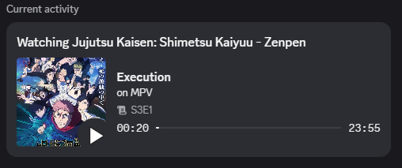 | 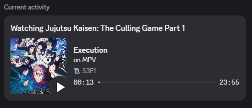 | 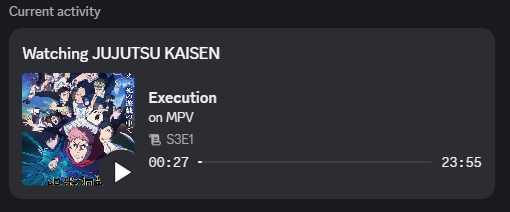 |

> Nome do arquivo (Filename) significa que o título do episódio é exibido com base no nome do arquivo (sem provedor de metadados).

### Títulos de episódios localizados (TVDB)
> Nota: titulos localizados são apenas disponíveis para o provedor de metadados TVDB.

| Inglês | Português | Espanhol |
| :---: | :---: | :---: |
|  | 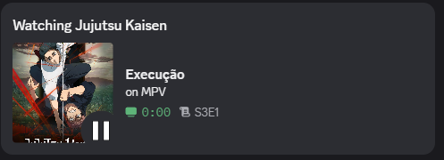 | 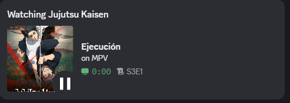 |

| Francês | Alemão | Italiano |
| :---: | :---: | :---: |
| 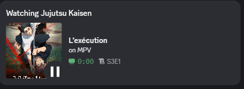 | 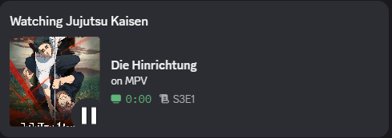 | 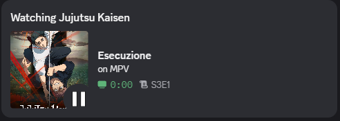 |

| Russo | Chinês | Japonês |
| :---: | :---: | :---: |
| 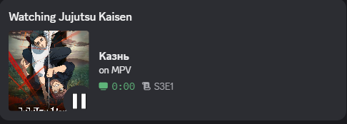 | 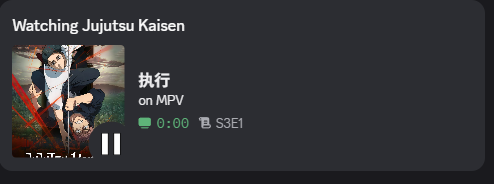 | 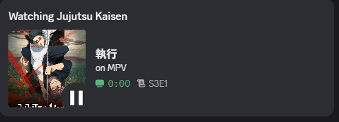 |

### Modo de privacidade

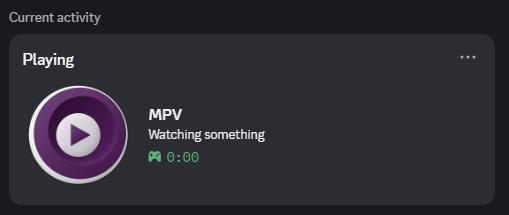

## Solução de problemas

| Problema | Verifique |
| --- | --- |
| Status não aparece no Discord | Discord Desktop aberto, `DISCORD_RPC=true`, app recompilado após mudar config |
| MPV não é detectado | `input-ipc-server` no `mpv.conf` bate com `MPV_IPC_PATH` |
| Botão do Stremio diz que o servidor está offline | Rode `npm run bridge` ou `npm run start:all` |
| Bridge funciona em porta custom no navegador, mas não no userscript | Atualize `CONFIG.SERVER_URL` no userscript |
| Título/episódio de anime parece errado | Limpe `.anime_cache/`, ative `DEBUG=true` e confira logs de parser/provedor |
| MAL ou Trakt não sincroniza | Rode novamente o comando de autenticação e confirme `*_SYNC=true` |


## Releases

As releases são automatizadas com **semantic-release** e separadas em dois fluxos independentes:

| App | Formato da tag | Changelog | Escopo |
| --- | --- | --- | --- |
| App RPC raiz | `mpv-rpc-v${version}` | `CHANGELOG.md` | Caminhos fora da bridge |
| Stremio bridge | `bridge-v${version}` | `stremio-mpv-bridge/CHANGELOG.md` | `stremio-mpv-bridge/**` |

Use Conventional Commits. Não rode `npm version` manualmente para releases do projeto.

Atalhos locais de release:

```bash
npm run release:dry
npm run release
npm run release:bridge:dry
npm run release:bridge
```

Para execuções locais do semantic-release, mantenha `GH_TOKEN` ou `GITHUB_TOKEN` no `.env`.

## Scripts recomendados para MPV

| Script | Descrição |
| --- | --- |
| [SmartSkip](https://github.com/Eisa01/mpv-scripts#smartskip) | Pula automaticamente intros, outros e silêncios |
| [SmartCopyPaste](https://github.com/Eisa01/mpv-scripts#smartcopypaste) | Copia/cola caminhos de vídeo, URLs e timestamps |

## Créditos

- [iamkroot/trakt-scrobbler](https://github.com/iamkroot/trakt-scrobbler) — implementação de referência para scrobble do Trakt.tv e OAuth device flow.
- [PreMiD](https://premid.app/) — referência de assets.

## Licença

Licença MIT. Veja [LICENSE](../LICENSE) para detalhes.
