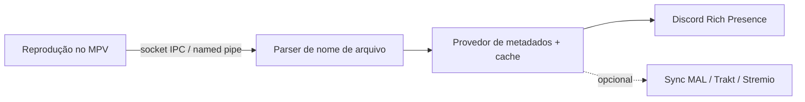
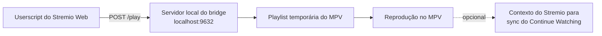

<div align="center">

<h1>
  
</h1>

**Discord Rich Presence para o MPV com metadados de anime, sincronização opcional de progresso e integração do Stremio Web com o MPV.**

<p>
  <a href="https://github.com/gabszap/mpv-rpc/releases"></a>
  <a href="https://github.com/gabszap/mpv-rpc/tree/main/stremio-mpv-bridge"></a>
  <a href="https://github.com/gabszap/mpv-rpc/actions/workflows/ci.yml"></a>
  
</p>
<p>
  
  
  
  
</p>

<p>
  <a href="#destaques">Destaques</a> ·
  <a href="#início-rápido">Início rápido</a> ·
  <a href="#bridge-do-stremio">Stremio</a> ·
  <a href="#serviços-de-sincronização">Sincronização</a> ·
  <a href="#referência-de-configuração">Configuração</a> ·
  <a href="#solução-de-problemas">Solução de problemas</a>
</p>


<br>
<em>Discord Rich Presence em ação</em>

<p>
  <a href="../README.md">English</a> · <a href="README_PT.md"><b>Português</b></a>
</p>

</div>

---

## Destaques

O **MPV Discord RPC** acompanha a reprodução do MPV via IPC e transforma isso em Rich Presence no Discord. Para arquivos de anime, ele analisa o nome do arquivo, busca metadados e capa, resolve títulos de episódios e pode sincronizar o progresso com MyAnimeList, Trakt.tv e Stremio. Para filmes e outras séries, pode buscar pôster, título oficial e ano no TMDb.

| | |
| --- | --- |
| **Discord Rich Presence** | Status em tempo real, estado pausado/reproduzindo, progresso, modo privacidade, opção para ocultar idle |
| **Metadados de anime** | Parsing de nome de arquivo, capa, títulos oficiais, títulos de episódio localizados, cache local |
| **Vários provedores** | Jikan/MyAnimeList, AniList, Kitsu e TheTVDB, com fallback automático |
| **Metadados de filmes e séries** | Pôster, título oficial, ano e nomes de episódio do TMDb para conteúdo que não é anime (precisa de uma `TMDB_API_KEY` gratuita) |
| **Parser resiliente** | PTT (TypeScript nativo) → regex de release de anime → regex fallback |
| **Sincronização** | Progresso no MyAnimeList, scrobble no Trakt.tv, Continue Watching e marcação de assistido no Stremio |
| **Bridge do Stremio** | Userscript + servidor local que abre streams do Stremio Web no MPV com suporte a playlists |

> [!NOTE]
> Arquivos de anime usam os provedores de anime. Filmes e outras séries usam o TMDb quando `TMDB_API_KEY` está definida, e recorrem aos provedores de anime se o TMDb não achar nada ou se o resultado parecer animação japonesa. Sem a chave, tudo funciona como antes.

Metadados e capas de filmes/séries ficam em `.anime_cache/media_cache.json` entre reinicializações (24 horas para resultados, 10 minutos para não encontrados). Nomes de episódio ficam só em memória. Séries usam o pôster principal do TMDb em `TMDB_LANG`, como as capas de anime usam `TVDB_LANG`: escolha `pt-BR` para português ou `en-US` para inglês. Requisições reais, falhas e tentativas do TMDb são sempre registradas em `.anime_cache/api_log.txt`, mesmo com `DEBUG=false`, sem credenciais. Acertos no cache não fazem requisições à API.

## Requisitos

- **Node.js 22** ou mais recente
- **MPV** Media Player
- **Discord Desktop**, se `DISCORD_RPC=true`
- *Opcional:* gerenciador de userscript, como Tampermonkey ou Violentmonkey, para a integração com o Stremio Web

## Início rápido

### 1. Instalar

```bash
git clone https://github.com/gabszap/mpv-rpc.git
cd mpv-rpc
npm install
```

### 2. Criar o `.env`

```bash
# Windows PowerShell
Copy-Item .env.example .env

# Linux/macOS
cp .env.example .env
```

Os padrões funcionam sem ajustes; edite os valores apenas para os recursos que você usar.

### 3. Habilitar IPC no MPV

Adicione isto ao seu `mpv.conf`:

```ini
# Windows
input-ipc-server=\\.\pipe\mpv

# Linux/macOS
input-ipc-server=/tmp/mpv-socket
```

Ou inicie o MPV manualmente com:

```bash
# Windows
mpv --input-ipc-server=\\.\pipe\mpv <arquivo>

# Linux/macOS
mpv --input-ipc-server=/tmp/mpv-socket <arquivo>
```

### 4. Compilar e executar

```bash
npm run build
npm start
```

Para desenvolvimento, compile e rode em um comando:

```bash
npm run dev
```

> [!TIP]
> Escolha o setup que combina com você: **só Discord** são exatamente os quatro passos acima. Para reproduzir o Stremio Web no MPV, continue na seção [Bridge do Stremio](#bridge-do-stremio).

## Bridge do Stremio

O **Stremio MPV Bridge** é um workspace separado: um userscript do Violentmonkey/Tampermonkey mais um servidor local que permite ao Stremio Web abrir streams diretamente no MPV, com modos de playlist single, batch ou série completa e configuração de provedores.

1. Complete o início rápido acima.
2. Instale `stremio-mpv-bridge/stremio-mpv.user.js` no seu gerenciador de userscript.
3. Inicie os dois serviços:

   ```bash
   npm run start:all
   ```

4. Abra `https://web.stremio.com/`, escolha um episódio ou filme e use o botão ou atalho do MPV Bridge.

Guia completo: [Guia do Stremio MPV Bridge](stremio-mpv-bridge.md)

## Serviços de sincronização

| Serviço | Ativar no `.env` | Comando de autenticação | Guia |
| --- | --- | --- | --- |
| **MyAnimeList** | `MAL_SYNC=true` | `npm start -- mal-auth` | [Guia MAL](mal-sync-setup.md) |
| **Trakt.tv** | `TRAKT_SYNC=true` | `npm start -- trakt-auth` | [Guia Trakt](trakt-sync-setup.md) |
| **Stremio** | `STREMIO_SYNC=true` | Abra uma mídia pelo bridge para capturar contexto/autenticação | [Guia Stremio](stremio-mpv-bridge.md) |

Tokens e contexto do Stremio ficam em `.config/`, que é ignorado pelo git.

> [!IMPORTANT]
> Alguns mapeamentos de sincronização de anime usam o TheTVDB para converter com segurança temporada+episódio (aired/default) em número de episódio absoluto, mesmo quando `METADATA_PROVIDER` não é `tvdb`. Defina `TVDB_API_KEY` nesses casos; sem ela, sincronizações ambíguas são ignoradas em vez de adivinhadas.

## Parsing de nome de arquivo

O parser tenta estes métodos, nesta ordem:

1. **PTT**: um parser nativo em TypeScript para nomes de release (`@aiostreams/release-parser`). Roda localmente, sem rede e sem Python, e extrai título, temporada, episódio, grupo de release, resolução e mais.
2. **Regex de release de anime**: usada para nomes no formato `[Grupo] Título - 05 [tags]` quando o PTT não está disponível ou o resultado dele não é aproveitável (por exemplo, o nome tem marcador de episódio, mas o PTT não encontrou o episódio).
3. **Regex genérico**: sempre disponível para extração básica de título/episódio.

> [!NOTE]
> Versões antigas usavam o GuessIt (uma ferramenta em Python, ou uma API pública). As variáveis `USE_GUESSIT_API` e `GUESSIT_API_URL` não são mais lidas; deixá-las no seu `.env` não causa problema.

## Referência de configuração

Copie `.env.example` para `.env` e ajuste apenas o que precisar. Valores ausentes usam os padrões do runtime.

<details>
<summary><b>Configurações principais</b></summary>

<br>

| Variável | Padrão | Descrição |
| --- | --- | --- |
| `DISCORD_CLIENT_ID` | ID do app incluído | Client ID do aplicativo Discord |
| `DISCORD_RPC` | `true` | Ativa o Discord Rich Presence |
| `SHOW_COVER` | `true` | Mostra a capa ou o pôster do filme/série quando disponível |
| `PRIVACY_MODE` | `false` | Oculta detalhes da mídia no Discord |
| `HIDE_IDLING` | `false` | Oculta a atividade enquanto o MPV está ocioso |
| `SHOW_TITLE` | `true` | Usa o título resolvido como nome da atividade no Discord |
| `TITLE_LANG` | `none` | Idioma do título de anime: `english`, `eng`, `romaji` ou `none`. Para resultados do TMDb só alterna entre o título oficial e o do arquivo (`none`); o idioma vem de `TMDB_LANG` |
| `DEBUG` | `false` | Grava logs detalhados de provedores/sincronização em `.anime_cache/` |
| `AUTO_FETCH` | `true` | Chave geral, do lado do RPC, para buscar automaticamente os próximos episódios. Também exige que a opção `autoFetch.enabled` da configuração do bridge esteja ATIVADA. |

</details>

<details>
<summary><b>Configurações do MPV e do bridge</b></summary>

<br>

| Variável | Padrão | Descrição |
| --- | --- | --- |
| `MPV_IPC_PATH` | Windows: `\\.\pipe\mpv`<br>Unix: `/tmp/mpv-socket` | Caminho do IPC compartilhado pelo app RPC e pelo bridge |
| `MPV_PATH` | `mpv` | Caminho do executável do MPV usado pelo bridge |
| `PORT` | `9632` | Porta do servidor do bridge |

Se você mudar `PORT`, atualize `CONFIG.SERVER_URL` em `stremio-mpv-bridge/userscript/src/constants.js` e rode `npm run build:userscript` para regenerar o `stremio-mpv-bridge/stremio-mpv.user.js`, de modo que o userscript aponte para a mesma URL do bridge.

</details>

<details>
<summary><b>Configurações de metadados e parser</b></summary>

<br>

| Variável | Padrão | Descrição |
| --- | --- | --- |
| `METADATA_PROVIDER` | `jikan` | Provedor de metadados: `jikan`, `anilist`, `kitsu` ou `tvdb` |
| `TVDB_API_KEY` | vazio | Chave da API do TheTVDB, necessária ao usar `tvdb` como provedor principal e para o mapeamento seguro da ordem de episódios na sincronização |
| `TVDB_LANG` | `eng` | Código de idioma do TheTVDB para os metadados de episódio |
| `TMDB_API_KEY` | vazio | Chave da API ou token de leitura do TMDb (crie em themoviedb.org/settings/api). Ativa os metadados de filmes e séries; sem ela o app se comporta como antes |
| `TMDB_LANG` | `en-US` | Idioma do TMDb para a capa principal, títulos e nomes de episódio (por exemplo `pt-BR`, `en-US`, `ja-JP`; aceita aliases `pt`/`por`, `en`/`eng`, `ja`/`jpn`) |

</details>

<details>
<summary><b>Configurações de sincronização</b></summary>

<br>

| Variável | Padrão | Descrição |
| --- | --- | --- |
| `MAL_SYNC` | `false` | Ativa a sincronização de progresso de episódios no MyAnimeList |
| `MAL_CLIENT_ID` | vazio | Client ID da API do MyAnimeList |
| `MAL_SYNC_THRESHOLD` | `90` | Percentual assistido para disparar a sincronização do MAL |
| `TRAKT_SYNC` | `false` | Ativa o scrobble no Trakt.tv |
| `TRAKT_CLIENT_ID` | vazio | Client ID da API do Trakt |
| `TRAKT_CLIENT_SECRET` | vazio | Client secret da API do Trakt |
| `TRAKT_SYNC_THRESHOLD` | `81` | Percentual assistido para disparar o scrobble do Trakt |
| `TRAKT_USE_TOR` | `false` | Roteia as requisições do Trakt por um proxy SOCKS5 do Tor |
| `TRAKT_TOR_PROXY` | `socks5://127.0.0.1:9050` | URL do proxy SOCKS5 do Tor |
| `STREMIO_SYNC` | `false` | Ativa o Continue Watching e a marcação de assistido no Stremio |
| `STREMIO_SYNC_THRESHOLD` | `85` | Percentual assistido para o Stremio marcar um item como assistido |
| `STREMIO_PROGRESS_INTERVAL_MS` | `90000` | Intervalo mínimo entre gravações do Continue Watching, limitado a no mínimo `30000` |
| `SYNC_DRY_RUN` | `false` | Quando ativado, todas as operações de sincronização (scrobble do Trakt, gravações no datastore do Stremio, requisições de Auto-Fetch, sync do MAL) são registradas em log mas NÃO executadas. Seguro para testar a configuração sem efeitos colaterais. |

</details>

### Auto-Fetch (porta dupla)

O Auto-Fetch tem duas portas independentes, e **as duas precisam estar `true`** para ele disparar:

| Porta | Onde | Papel |
| --- | --- | --- |
| `.env` → `AUTO_FETCH` (padrão `true`) | Lado do RPC | Chave geral. Quando `false`, o RPC nunca dispara o auto-fetch, independentemente da configuração do bridge. |
| Config do bridge → `autoFetch.enabled` | Modal do userscript (Playback → Auto-Fetch Episodes) | Controle fino por instância. Quando DESATIVADO, o bridge ignora requisições de auto-fetch mesmo que o RPC dispare. |

> [!TIP]
> Na prática, normalmente basta desativar o Auto-Fetch nas configurações do bridge. Defina `AUTO_FETCH=false` apenas quando quiser uma chave geral.

## Como funciona



O bridge do Stremio roda separadamente:



## Capturas de tela

### Modos de exibição do título

| Título em romaji | Título em inglês | Nome do arquivo (fallback) |
| :---: | :---: | :---: |
|  |  |  |

> *Nome do arquivo* significa que o título do anime é tirado do nome do arquivo (nenhum provedor de metadados é usado).

### Títulos de episódio localizados (TVDB)

> [!NOTE]
> Títulos de episódio localizados só estão disponíveis com o provedor de metadados TVDB.

| Inglês | Português | Espanhol |
| :---: | :---: | :---: |
|  |  |  |

| Francês | Alemão | Italiano |
| :---: | :---: | :---: |
|  |  |  |

| Russo | Chinês | Japonês |
| :---: | :---: | :---: |
|  |  |  |

### Modo de privacidade

<p align="center">
  
</p>

## Solução de problemas

| Problema | O que verificar |
| --- | --- |
| O status do Discord não aparece | O Discord Desktop está aberto, `DISCORD_RPC=true` e o app foi recompilado depois de mudar a configuração |
| O MPV não é detectado | O `input-ipc-server` no `mpv.conf` coincide com o `MPV_IPC_PATH` |
| O botão do Stremio diz que o servidor está offline | Rode `npm run bridge` ou `npm run start:all` |
| O Stremio funciona numa porta personalizada no navegador, mas não no userscript | Atualize `CONFIG.SERVER_URL` em `stremio-mpv-bridge/userscript/src/constants.js` e rode `npm run build:userscript` |
| O título/episódio do anime parece errado | Limpe `.anime_cache/`, ative `DEBUG=true` e confira os logs do parser/provedor |
| MAL ou Trakt não sincroniza | Rode o comando de autenticação de novo e confirme a opção `*_SYNC=true` correspondente |

## Desenvolvimento

```bash
npm install          # instala as dependências
npm run build        # compila o TypeScript para dist/
npm test             # roda a suíte de testes (Vitest)
npm run check        # lint e formatação (Biome)
```

O userscript do Stremio é **gerado**: edite `stremio-mpv-bridge/userscript/src/` (e o `header.txt`) e rode `npm run build:userscript`. O `npm run check:userscript` falha quando o `stremio-mpv.user.js` commitado está desatualizado. O CI roda lint, build, testes e a verificação do userscript em todo pull request.

Mais: [Arquitetura](ARCHITECTURE.md) · [Contribuindo](CONTRIBUTING.md) · [Roadmap](ROADMAP.md) · [AGENTS.md](../AGENTS.md)

### Releases

As releases são automatizadas com **semantic-release** e divididas em dois fluxos independentes:

| App | Formato da tag | Changelog | Escopo |
| --- | --- | --- | --- |
| App RPC (raiz) | `mpv-rpc-v${version}` | `CHANGELOG.md` | Caminhos fora do bridge |
| Stremio bridge | `bridge-v${version}` | `stremio-mpv-bridge/CHANGELOG.md` | `stremio-mpv-bridge/**` |

Use Conventional Commits. Não rode `npm version` manualmente nas releases do projeto.

Comandos locais de release:

```bash
npm run release:dry
npm run release
npm run release:bridge:dry
npm run release:bridge
```

Para rodar o semantic-release localmente, mantenha `GH_TOKEN` ou `GITHUB_TOKEN` no `.env`.

## Scripts recomendados para o MPV

| Script | Descrição |
| --- | --- |
| [SmartSkip](https://github.com/Eisa01/mpv-scripts#smartskip) | Pula automaticamente aberturas, encerramentos e silêncio |
| [SmartCopyPaste](https://github.com/Eisa01/mpv-scripts#smartcopypaste) | Copia/cola caminhos de vídeo, URLs e timestamps |

## Créditos

- [iamkroot/trakt-scrobbler](https://github.com/iamkroot/trakt-scrobbler): implementação de referência para o scrobble do Trakt.tv e os padrões do fluxo de dispositivo OAuth.
- [PreMiD](https://premid.app/): referência de assets.

## Licença

Licença MIT. Veja [LICENSE](../LICENSE) para detalhes.
